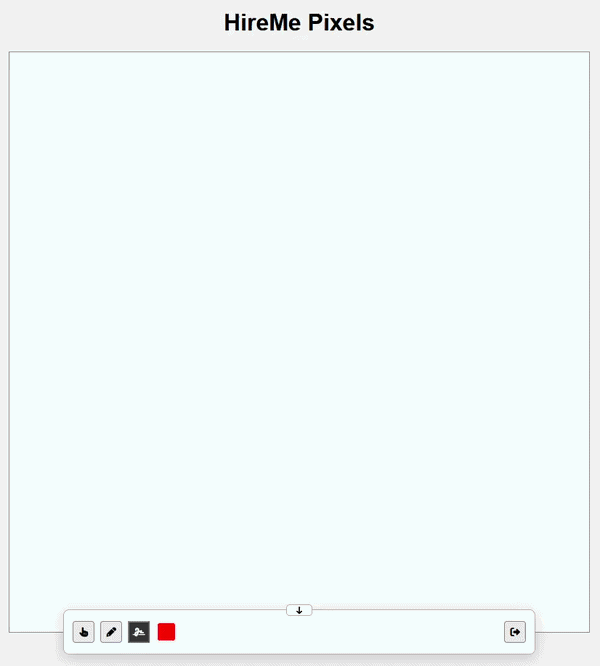

# HireMe-Pixels

**Live application:** https://hireme.lippay.ro

  

HireMe Pixels is a real-time collaborative pixel board and an end-to-end Cloud and DevOps project. The application stays deliberately focused so the engineering work can center on building, deploying, and operating reliable cloud infrastructure.

## Highlights

* **Collaborative application:** A 100×100 board supports pixel editing, pencil drawing, live updates, and pixel-change attribution.
* **Authentication and moderation:** Users can sign in with local accounts or Microsoft Entra ID. Administrators can ban users and restore pixels from their history.
* **Real-time, horizontally scaled backend:** Azure Container Apps scales backend replicas based on HTTP load; Django Channels and Redis keep connected clients in sync across replicas.
* **Azure infrastructure as code:** Terraform manages Azure Container Apps, Azure Container Registry, managed PostgreSQL, DNS, certificates, and supporting resources.
* **Automated delivery:** GitHub Actions validates pull requests and deploys application images to development and production environments.

## Technology

* **Application:** Django, Django REST Framework, Django Channels, HTML, CSS, JavaScript
* **Data and messaging:** Azure Database for PostgreSQL, Redis
* **Cloud and infrastructure:** Microsoft Azure, Azure Container Apps, Azure Container Registry, Terraform, Terraform Cloud
* **Delivery and local orchestration:** GitHub Actions, Docker, Kubernetes with kind
* **Identity and edge services:** Microsoft Entra ID, Azure DNS, managed certificates

## Environments

| Environment | Application | API |
| --- | --- | --- |
| Production | https://hireme.lippay.ro | https://api.hireme.lippay.ro/api/ |
| Development | https://hiremedev.lippay.ro | https://api.hiremedev.lippay.ro/api/ |
| Local | https://hiremelocal.lippay.ro | https://api.hiremelocal.lippay.ro/api/ |

Pushes to `main` deploy development; pushes to `production` deploy production. Terraform Cloud keeps the environments' remote state separate.

## Local Development

For live development on feature branches, use the root `Makefile` targets in order:

1. `make local-prepare` creates or updates the Azure foundation, including the container registry and its dependencies, without deploying the application containers.
2. `make local-push` builds the backend, frontend, and Redis Docker images and pushes them to that registry.
3. `make local-plan` previews the application deployment in the `local` Terraform Cloud workspace.
4. `make local-deploy` creates or updates the Container Apps to run the pushed images.

These targets select the `local` Terraform Cloud workspace by default. Set `TERRAFORM_WORKSPACE` to intentionally target another workspace.

To run the application locally with Docker and Kubernetes using kind. The root `Makefile` again provides the main lifecycle:

1. `make start` builds the images, creates the kind cluster if needed, deploys the workloads, and waits for them to become ready.
2. `make logs` shows Kubernetes workload logs. The backend and frontend can also be developed independently using their own Makefiles and Dockerfiles.
3. `make clean` removes the cluster and its data. The next `make start` recreates everything from scratch.
4. `make stop` stops workloads while preserving the cluster and its data.

